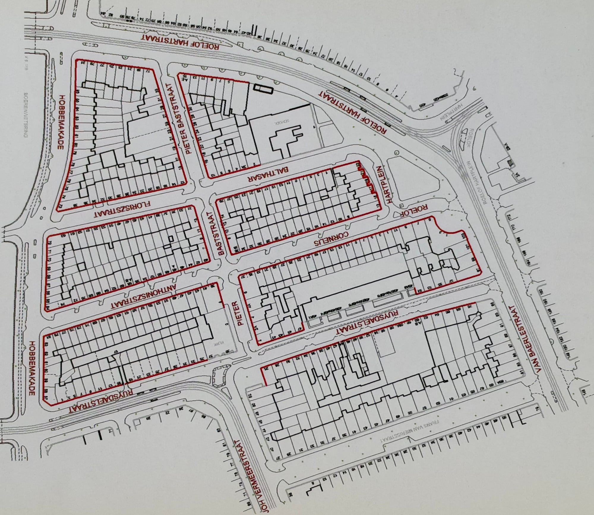

# Duivelseiland 1898 - 2004

Amsterdam Oud Zuid

_Omslag: luchtfoto van Duivelseiland met de titel "Duivelseiland 1898 - 2004" en het logo van stadsdeel Amsterdam Oud Zuid. Luchtfoto 2 september 2004, Het Parool (zie colofon). De scan staat niet in de repo: Het Parool heeft (nog) geen toestemming gegeven._

## Kaart van Duivelseiland (p. 2)

_Geen bijschrift in het boekje. De bouwblokken van Duivelseiland zijn rood omlijnd._

## Inhoudsopgave

| Hoofdstuk               | Pagina |
| ----------------------- | -----: |
| Voorwoord               |      5 |
| Duivelseiland           |      7 |
| Cornelis Anthoniszstraat |     9 |
| Balthasar Floriszstraat |     15 |
| Pieter Baststraat       |     21 |
| Roelof Hartstraat       |     27 |
| Roelof Hartplein        |     31 |
| Hobbemakade             |     35 |
| Ruysdaelstraat          |     39 |
| Nawoord                 |     45 |
| Colofon                 |     46 |
| CD-rom                  |     47 |

_De paginanummers in de inhoudsopgave liggen twee hoger dan de nummers die op de pagina's zelf staan (het voorwoord staat op p. 3). Deze uitwerking gebruikt de nummers op de pagina's._
