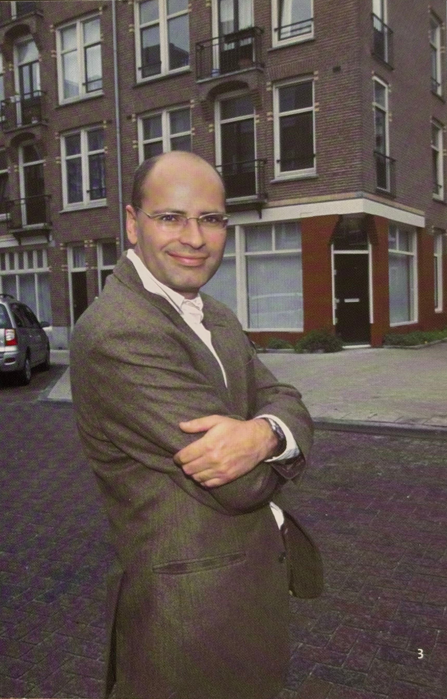

# Voorwoord

Dit boekje is ter afronding van de stadsvernieuwing in Duivelseiland die van 1997 tot en met 2004 duurde. In totaal zijn 272 panden en ruim 900 woningen opgeknapt. Mede dankzij gemeentelijke subsidies voor woningverbetering zijn veel eigenaren aan de slag gegaan. Daarnaast zijn alle straten en stoepen opnieuw ingericht, is er nieuwe riolering aangebracht en zijn de waterleidingen waar nodig vernieuwd. Al met al een omvangrijke klus die met name de laatste jaren goed op stoom is gekomen. Op de cd-rom achterin dit boek vindt u panoramafoto's die een mooi beeld geven van Duivelseiland na de stadsvernieuwing.

Door de gezamenlijke inspanning van particuliere eigenaren, bewoners, corporaties, het woonspreekuur, de bewonersgroep Duivelseiland, overige organisaties en medewerkers van het stadsdeel Oud Zuid is Duivelseiland wat het nu is. Dit betekent niet dat de buurt 'af' is. Dat een buurt zich altijd blijft vernieuwen blijkt uit dit boekje. Fred van Kooij, actief in de bewonersgroep Duivelseiland en jarenlang bewoner, heeft voor dit boekje in zijn geheugen en in de archieven gegraven om u iets te vertellen over de geschiedenis van de buurt. Ik wens u veel woon-, werk- en leesplezier in Duivelseiland.

Emile Jaensch
Projectwethouder Duivelseiland

_Geen bijschrift in het boekje; de foto staat naast het voorwoord van Emile Jaensch._
