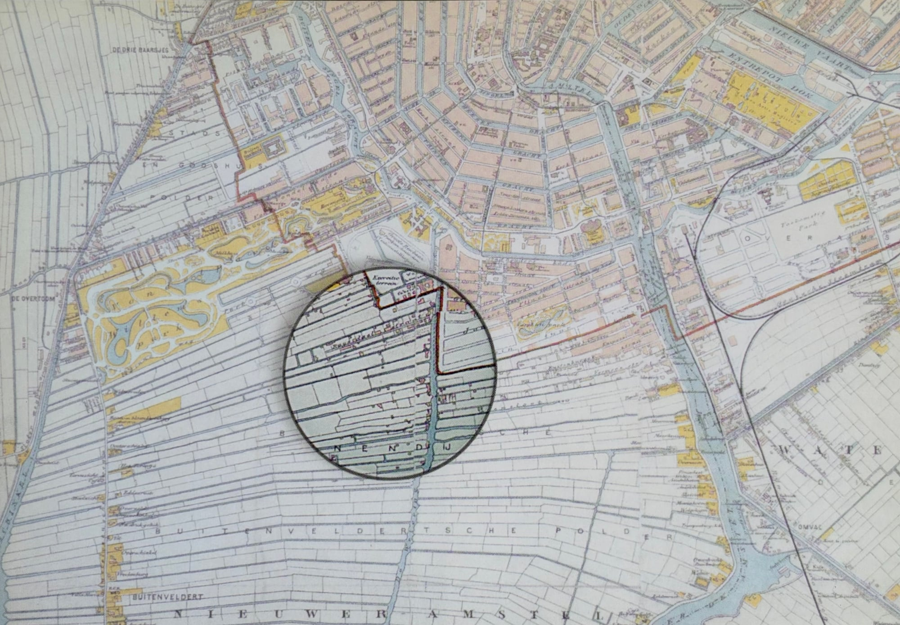
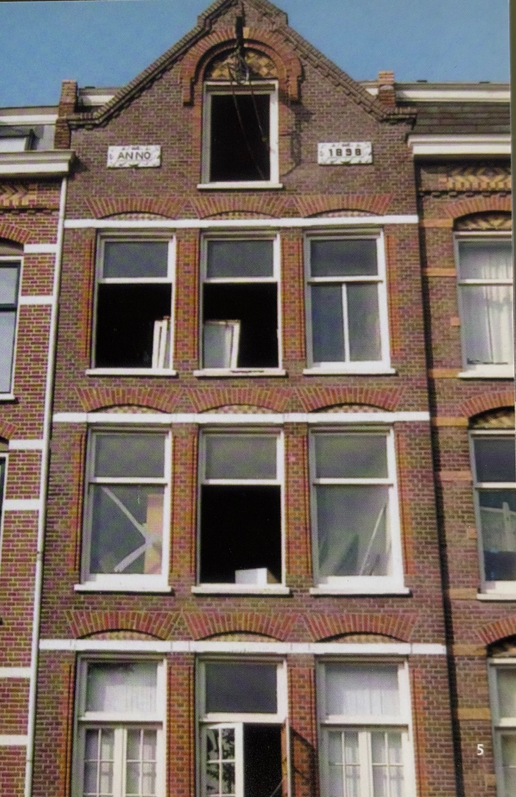

# Duivelseiland

_Een aparte naam voor een aparte buurt_

Omstreeks 1897 werd een driehoekig stuk grond aan de Boerenwetering met zand opgehoogd om er huizen op te laten bouwen[^1]. Je kon er vanaf de Albert Cuypstraat heen via een smalle houten brug over het water. Tot mei 1896 behoorde de grond bij de gemeente Nieuwer-Amstel (nu Amstelveen). Het was een onverlichte en nogal rommelige uithoek.

In die tijd stonden de kranten vol over de Dreyfus-affaire. Een kapitein van het Franse leger was veroordeeld tot levenslange opsluiting op het rotsachtige kale Duivelseiland, gelegen voor de kust van Frans Guyana. Schrijvers als Emile Zola betoogden dat Dreyfus ten onrechte was beschuldigd van landverraad en dat leidde uiteindelijk tot zijn eerherstel. Omwonenden die 's avonds over het onherbergzame bouwterrein aan de Boerenwetering liepen, slaakten de verzuchting: "het lijkt hier wel Duivelseiland!" Deze roepnaam is later door de gemeente Amsterdam overgenomen voor wijk nummer 50, die wordt begrensd door de Hobbemakade, de Ruysdaelstraat en de Roelof Hartstraat. Stembusuitslagen van wijk 50 staan in de pers ook nog steeds onder het kopje Duivelseiland.

Duivelseiland wordt gerekend tot het Museumkwartier Oost. Maar qua bouwstijl en sfeer wijkt het af van de aangrenzende straten. Met recht een aparte buurt, die na de stadsvernieuwing weer gezien mag worden.

[^1]: De eerste nieuwbouw vond plaats in 1898. Het jaartal is nog te zien boven in de gevel van Hobbemakade 65.

## Foto's

_Kaart van Amsterdam en omgeving in 1893_ (p. 4)

_Geen bijschrift in het boekje. Gezien de voetnoot vermoedelijk de gevel van Hobbemakade 65 met het jaartal 1898._ (p. 5)
