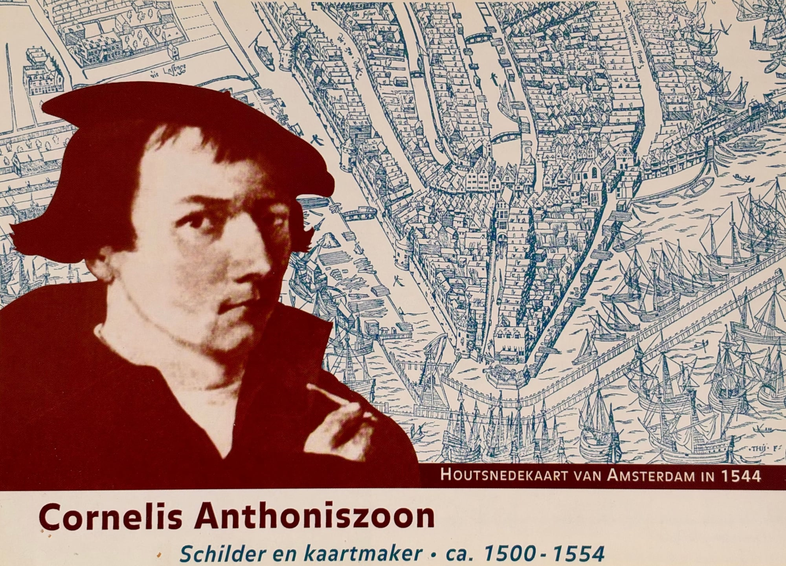
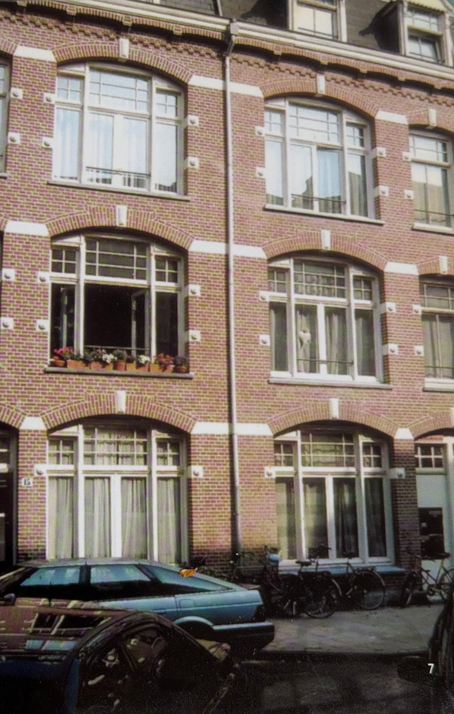
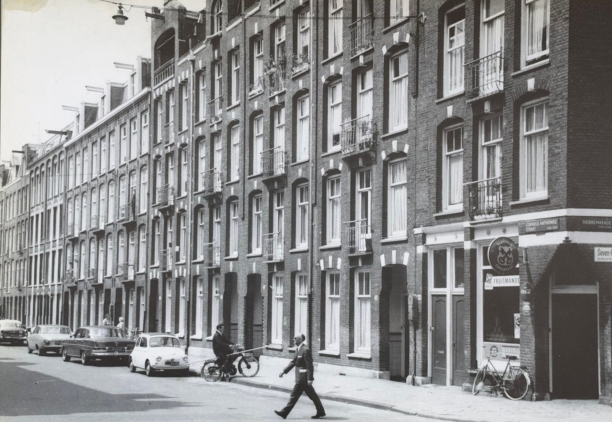
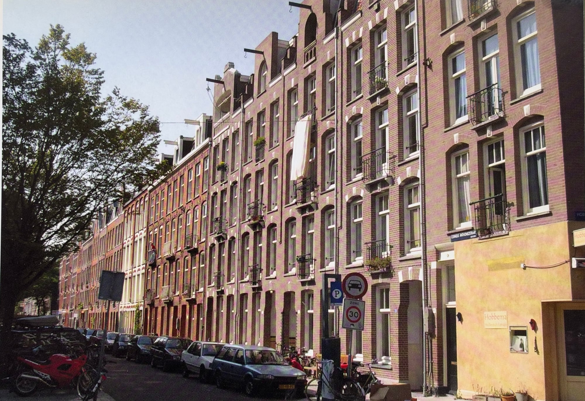
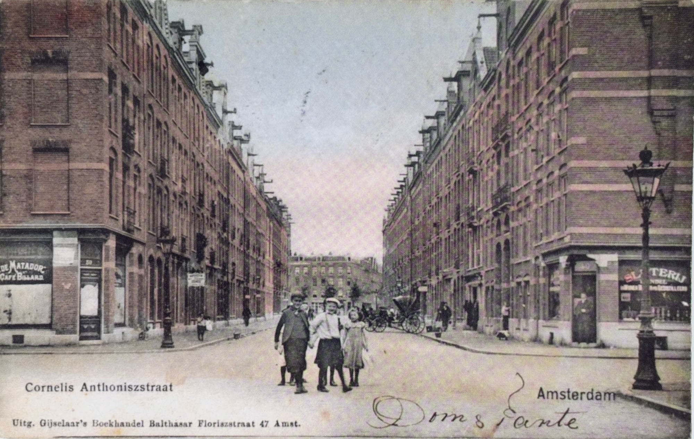
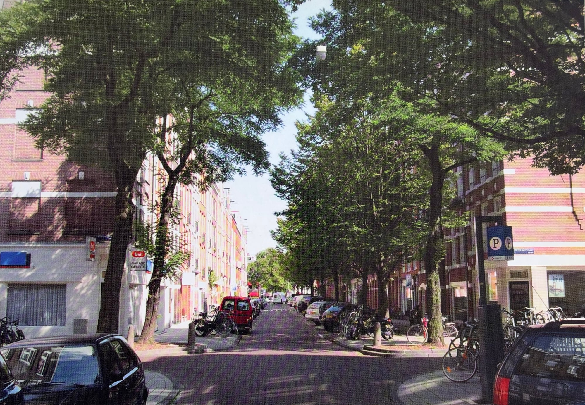

# Cornelis Anthoniszstraat

**Cornelis Anthoniszoon**
_Schilder en kaartmaker · ca. 1500 - 1554_
_Achtergrond: houtsnedekaart van Amsterdam in 1544_ (p. 6)

_Vroeger en nu_

De huizen aan beide zijden van de straat dateren uit het jaar 1900. Twee bouwkundigen speelden daarbij de hoofdrol, te weten P.J. van Doorn die de huisnummers 1 tot en met 25, 8-18, 24-30 en 40-60 ontwierp en J.H. Göttmer, die tekende voor de percelen 57 tot en met 81. Op nummer 13 en 15 zijn brede vensters te zien met zijlichten aan de linker- en rechterkant. Dit is een uitzondering op de drie ramen van gelijke breedte die in oude woonwijken veelvuldig werden toegepast. Bij de renovatie zijn de dakkapellen en andere historische details van dit blok gerestaureerd.

Tegenwoordig is de Cornelis Anthoniszstraat een typische woonstraat met veel jonge gezinnen en alleenstaanden. Aan vele onderpuien is nog steeds te zien dat er vroeger overal winkels en bedrijfjes zaten. In het begin van de twintigste eeuw kon je daar aan de rand van de stad goed je brood verdienen. Neem bijvoorbeeld nummer 22-huis met de houten onderpui, waar je letterlijk met de deur in huis valt. Voor de oorlog zat er een stukadoorswerkplaats. Achter de etalage van 32 heeft eens een melkinrichting gezeten en op nummer 48 werd in het begin banket en later groente verkocht.

Nog steeds is er bedrijvigheid in de hoekpanden bij de kruising met de Pieter Baststraat. Op nummer 40 waar nu een haarstudio is gevestigd, zat meer dan tachtig jaar de drankenhandel van Doorenbosch/Wolters. Nummer 39 was voor de verbouwing tot garagebedrijf een café met biljart. Op nummer 23 zat eens een zaal voor bruiloften en partijen en jarenlang werd brood verkocht op Cornelis Anthoniszstraat 43.

## Foto's

_Geen bijschrift in het boekje. Op de foto is huisnummer 15 te zien: vermoedelijk de brede vensters met zijlichten van nummer 13 en 15 uit de tekst._ (p. 7)

### Oneven zijde, toen en nu

_Oneven zijde Cornelis Anthoniszstraat in 1968_ (p. 8)

_Oneven zijde Cornelis Anthoniszstraat anno 2004_ (p. 9)

### Gezien naar de Hobbemakade, toen en nu

_Corn. Anthoniszstraat gezien naar de Hobbemakade op een prentbriefkaart van 1904_ (p. 10)

_Corn. Anthoniszstraat gezien naar de Hobbemakade anno 2004_ (p. 11)
