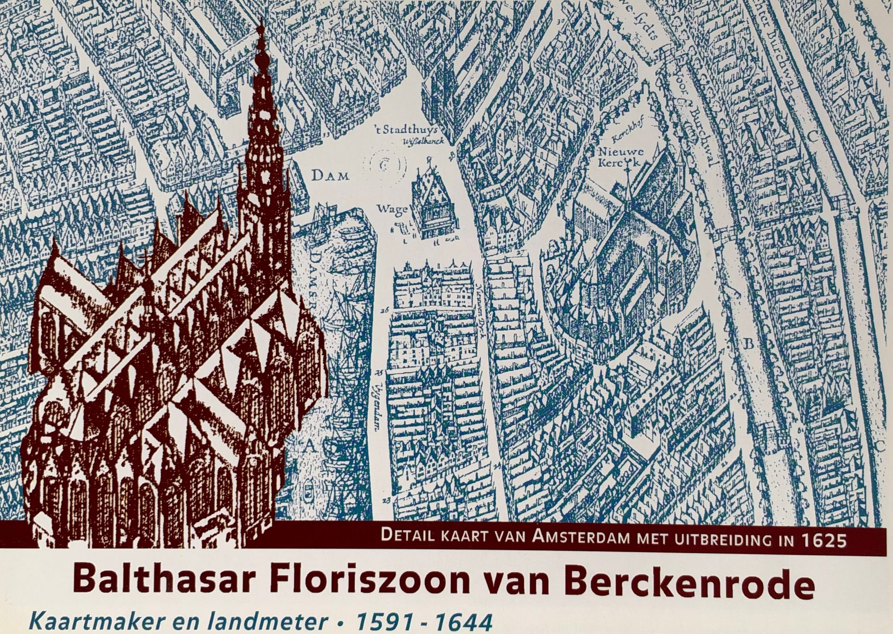
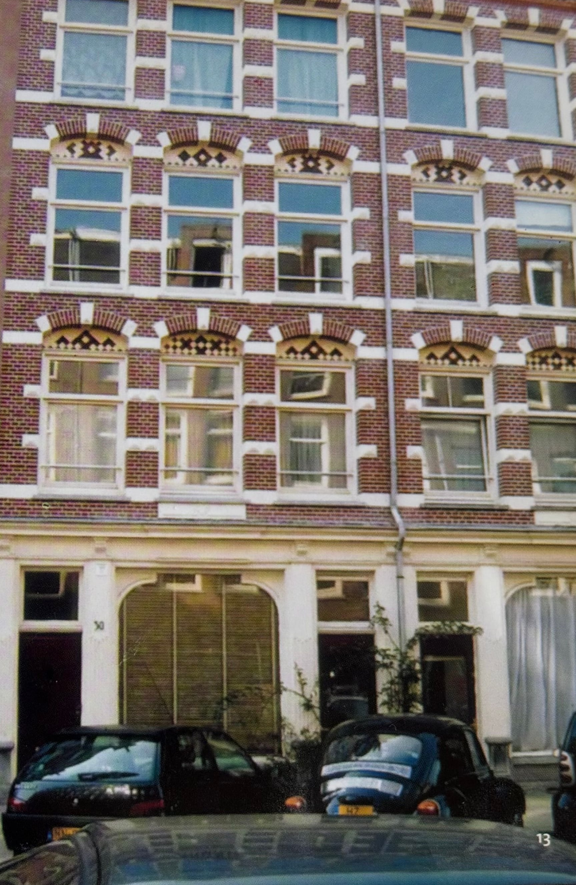
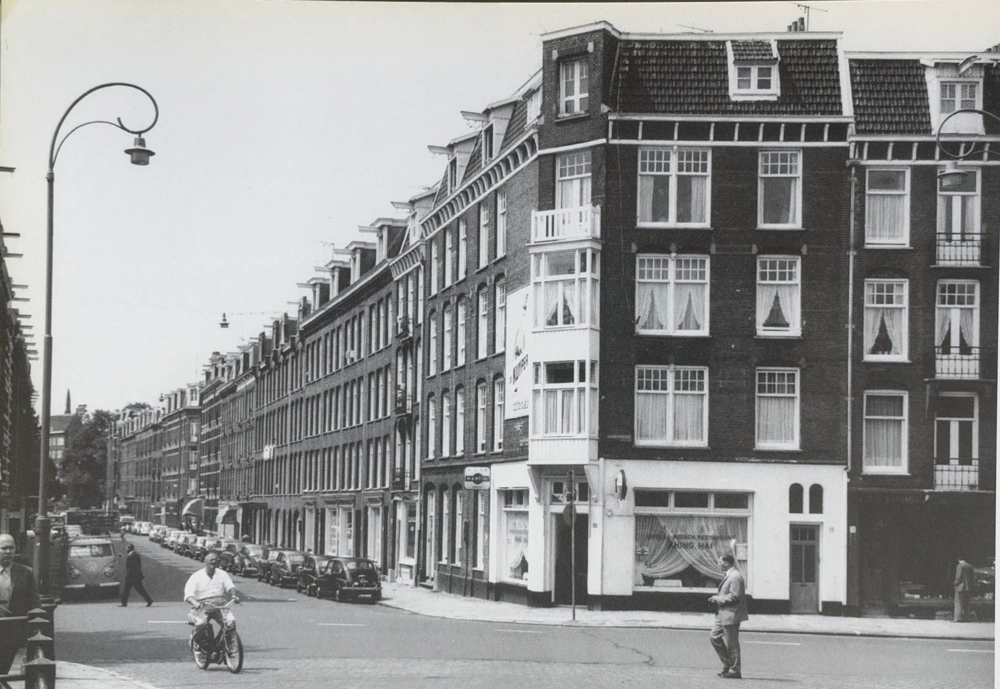
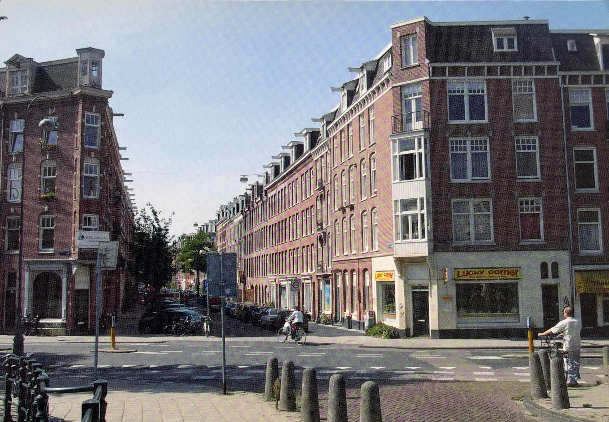
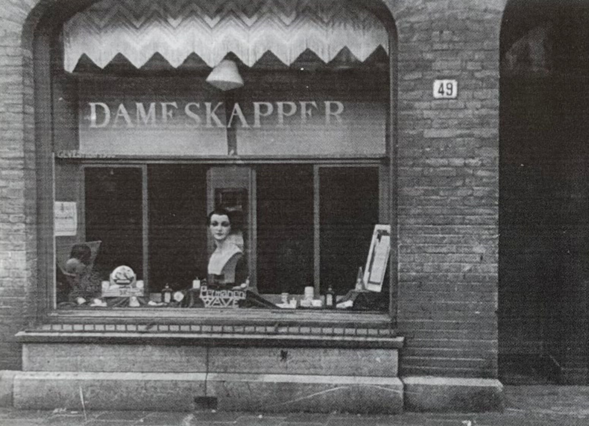
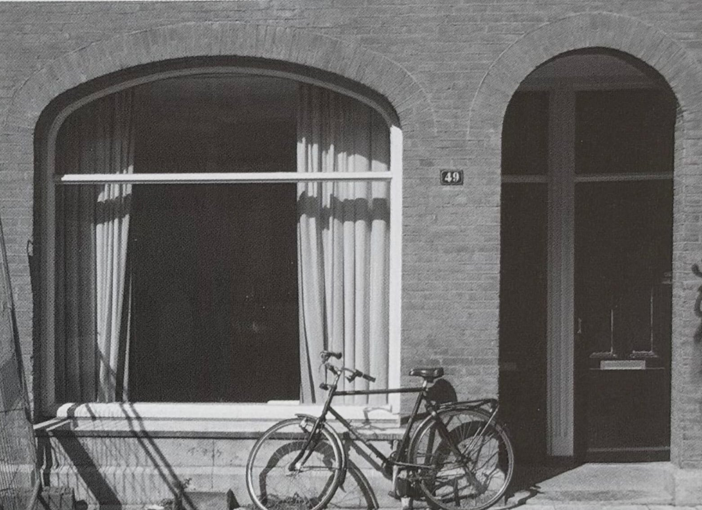
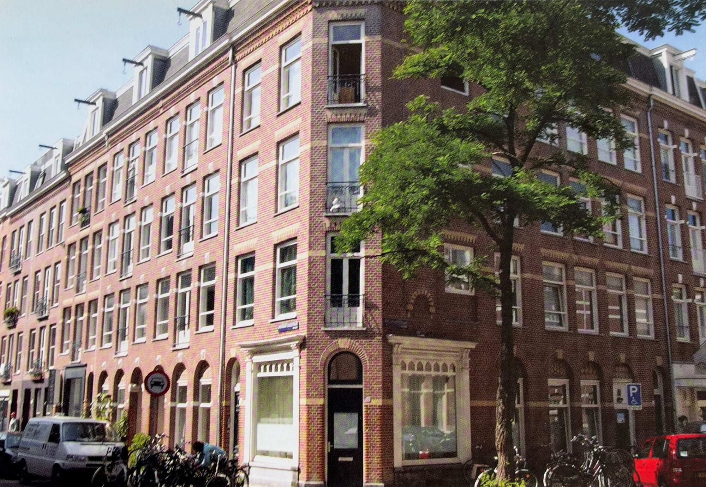

# Balthasar Floriszstraat

**Balthasar Floriszoon van Berckenrode**
_Kaartmaker en landmeter · 1591 - 1644_
_Achtergrond: detail kaart van Amsterdam met uitbreiding in 1625_ (p. 12)

_Vroeger en nu_

Ook deze straat werd volgebouwd in 1899 en 1900. Nu de meeste voorgevels zijn gereinigd, valt op dat een paar ontwerpers de nogal uniforme woningen uit die tijd hebben voorzien van opvallende motieven. Boven de ramen van de huisnummers 24 tot en met 30 bevinden zich erg fraaie patronen van gekleurde baksteen. Boven de huisdeuren van 32-34 prijken kraanvogels aan weerszijden van bomen in een simpele Jugendstilvorm.

Vroeger stonden er geen bomen in deze straat. Tijdens de herinrichting van de straten in 1998 zijn er bomen geplaatst zodat de straat tegenwoordig een veel groenere aanblik vertoont.

Tot in de jaren vijftig van de vorige eeuw kende de Balthasar Floriszstraat een ruime keuze aan winkels. Op nummer 11 zat ondermeer een verfhandel, op 19 een houthandel, op 29 een banketbakkerij en een dameskapper op 49. Aan de overkant was rond 1949 op nummer 10 een papierhandel gevestigd en op nummer 14 een meubelmakerij. Op huisnummer 2 zat vanouds de conciërgewoning die deel uitmaakte van de school. Toen de school in bezit kwam van het ROC van Amsterdam, kreeg dit lage pand een woonbestemming.

## Foto's

_Geen bijschrift in het boekje. Vermoedelijk de gekleurde baksteenpatronen boven de ramen van nummer 24 tot en met 30 uit de tekst._ (p. 13)

### Vanaf de kade, toen en nu

_Balthasar Floriszstraat vanaf de kade op een foto uit 1968. Er was nog geen éénrichtingsverkeer_ (p. 14)

_Balthasar Floriszstraat vanaf de kade anno 2004_ (p. 15)

### Nummer 49, toen en nu

_De etalage van de dameskapper in de Balthasar Floriszstraat omstreeks 1940_ (p. 16)

_Balthasar Floriszstraat 49-huis in 2004_ (p. 16)

### Hoek Pieter Baststraat

_Balthasar Floriszstraat hoek Pieter Baststraat anno 2004_ (p. 17)
