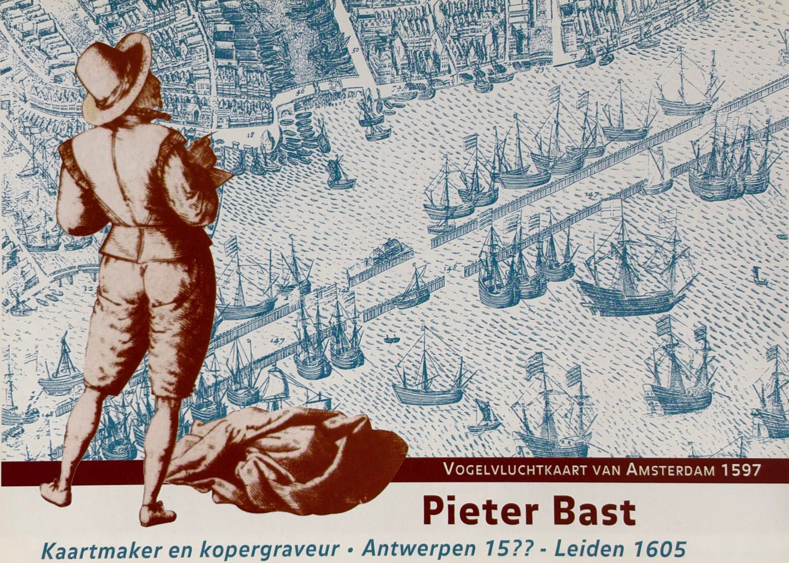
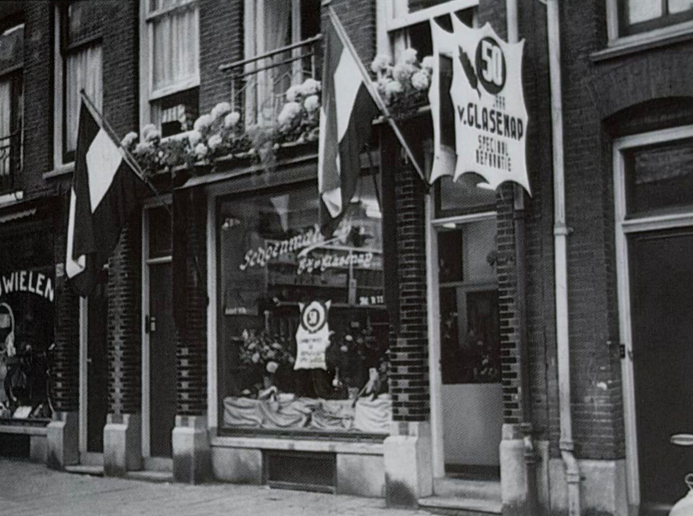
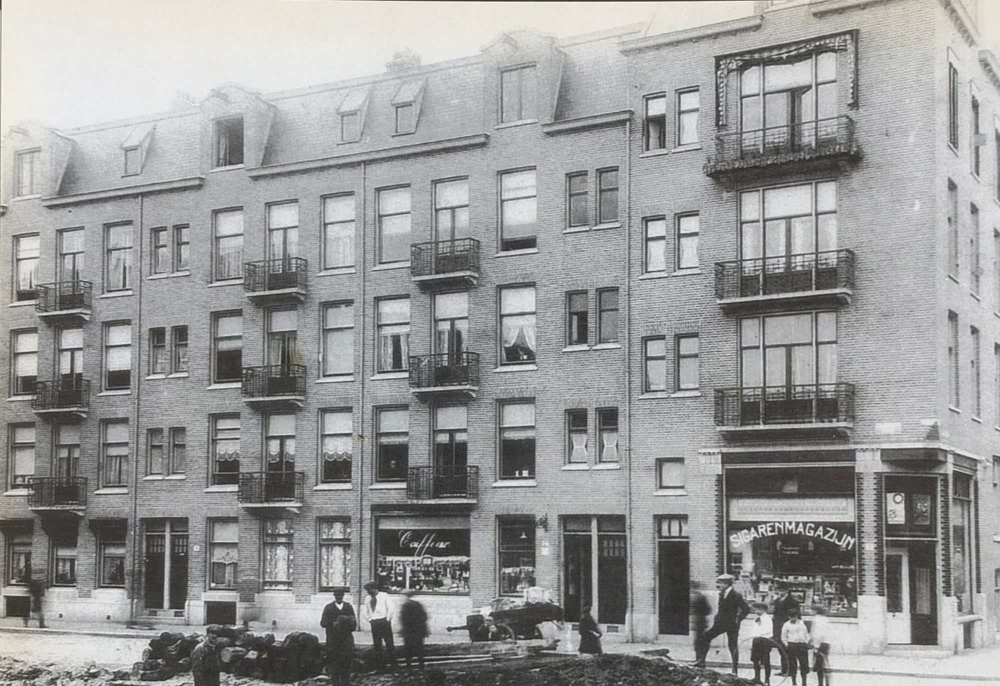
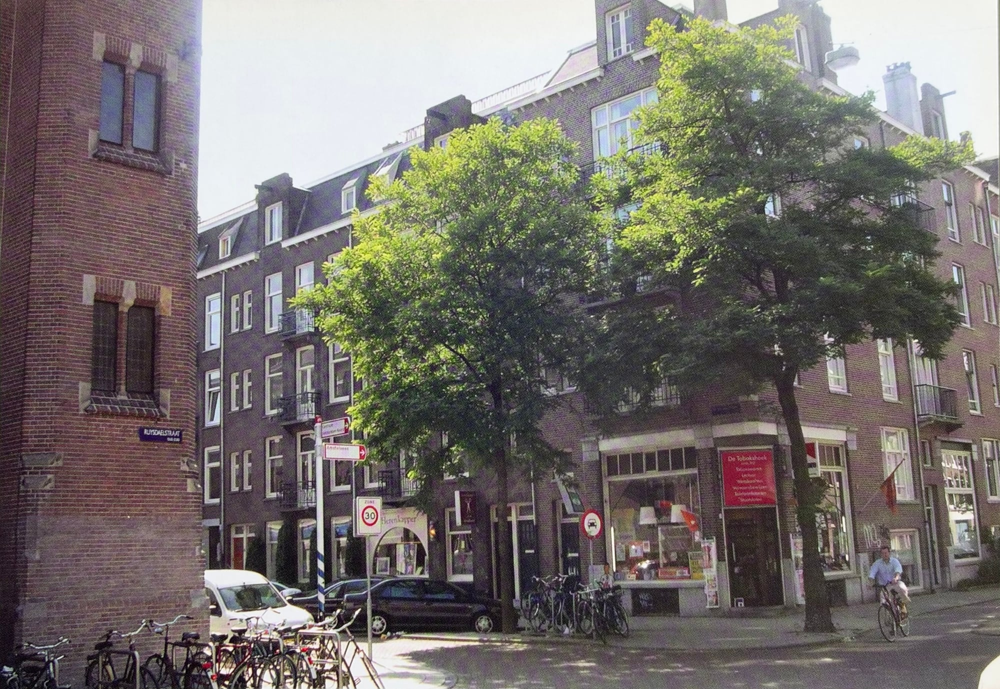
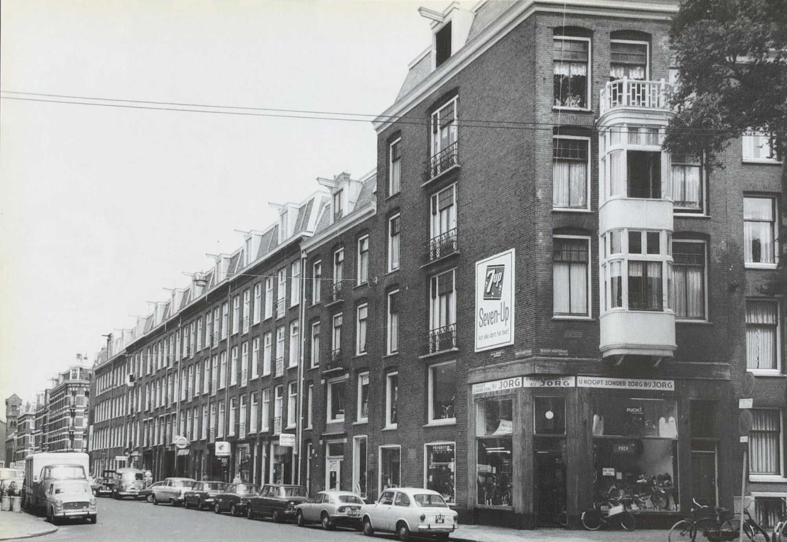
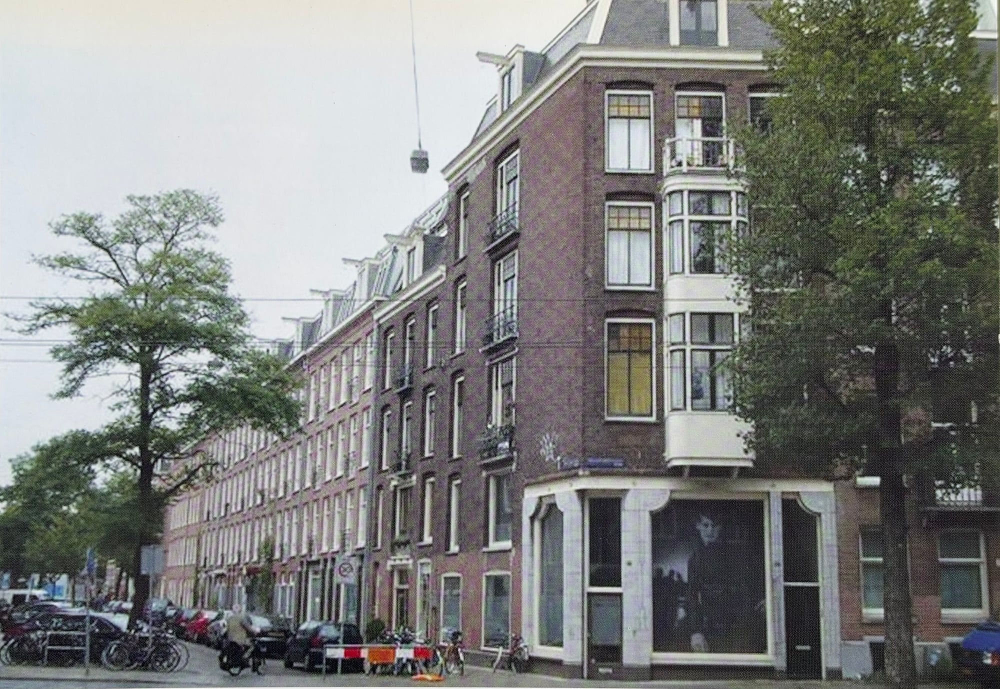

# Pieter Baststraat

**Pieter Bast**
_Kaartmaker en kopergraveur · Antwerpen 15?? - Leiden 1605_
_Achtergrond: vogelvluchtkaart van Amsterdam 1597_ (p. 18)

_Het hart van de buurt_

Deze straat was vanaf het prille begin een goede plek voor het starten van een winkel of een zelfstandige onderneming. Drie winkels zijn uniek. Zo bevindt zich al sinds 1912 op nummer 2 een sigarenwinkel. Op nummer 2a startte Chr. Sorel in datzelfde jaar een kapperszaak en ook vandaag de dag is hier nog een kapsalon gevestigd. Al sinds 1924 is er een bakkerij op nummer 12. Op het bord aan de gevel staat dat Van Groenestein er al sinds 1950 voor vers brood en gebak garant staat.

Van 1906 tot 2003, dus bijna een eeuw en drie generaties lang, zat schoenmakerij Van Glasenap op Pieter Baststraat 31. Een ingrijpende renovatie van dit pand was aanleiding voor de schoenmaker om ermee te stoppen. Ook de melkboer en groentezaak hebben onlangs hun zaak gesloten. Maar er zijn ook nieuwe ondernemers die zich in de buurt vestigen. Zo is er een kunstzaak en speelgoedwinkeltje.

In het lijstje van oudgedienden mag ook de naam Jorg niet ontbreken: eens begonnen op de hoek van de Roelof Hartstraat met de verkoop van fietsen en brommers en na de jaren vijftig voortgezet als rijwielstalling op nummer 19. In het garagebedrijf op nummer 5 op de hoek met de C. Anthoniszstraat was voor de oorlog de NV Autokluis gevestigd. Daar kon je je wagen in een autobox parkeren.

## Foto's

_Geen bijschrift in het boekje. Op de foto de etalage van schoenmakerij Van Glasenap, versierd met vlaggen en een bord "50 jaar"._ (p. 19)

### Begin van de straat, toen en nu

_Deze fotokaart, waarschijnlijk gemaakt in 1913, toont het pas gebouwde rijtje huizen aan de Pieter Baststraat 2- 6. De kerk er tegenover kwam een jaar later gereed_ (p. 20)

_Anno 2004 vinden we nog steeds een sigarenwinkel en een herenkapper aan het begin van de Pieter Baststraat_ (p. 21)

### Oneven zijde, toen en nu

_Oneven zijde van de Pieter Baststraat op 12 juli 1968_ (p. 22)

_Oneven zijde Pieter Baststraat anno 2004_ (p. 23)
