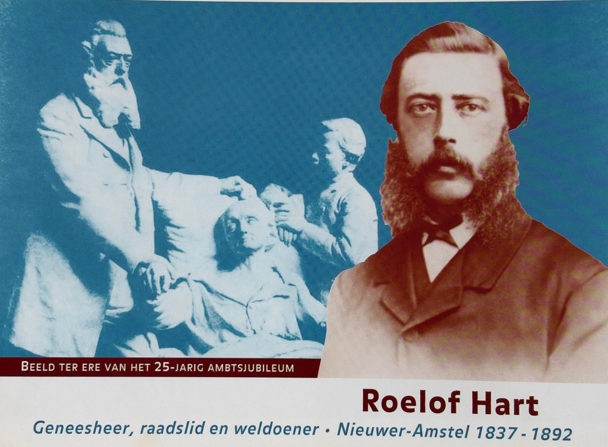
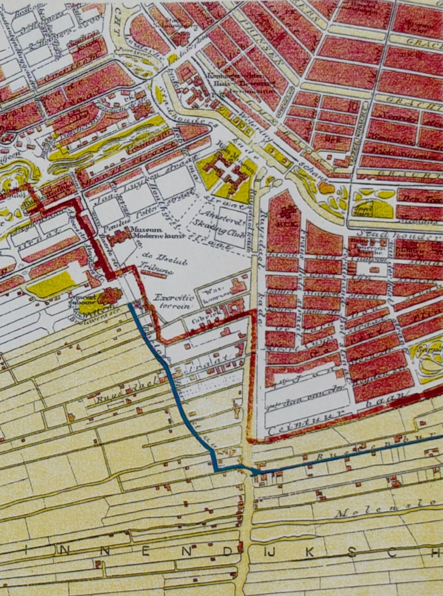
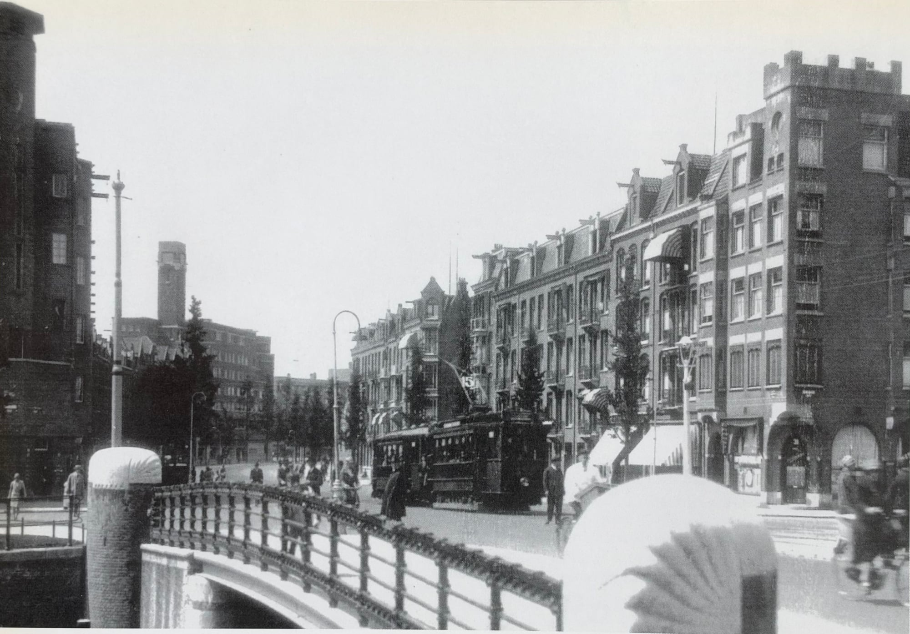
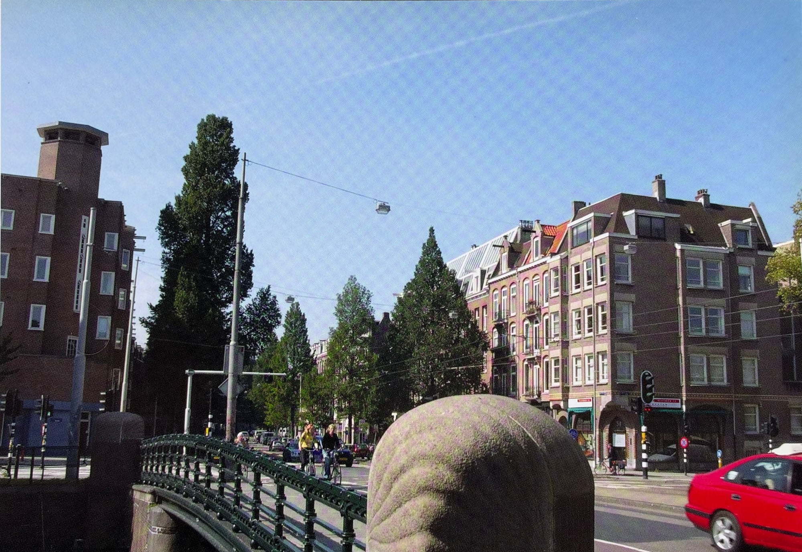

# Roelof Hartstraat

**Roelof Hart**
_Geneesheer, raadslid en weldoener · Nieuwer-Amstel 1837 - 1892_
_Links: beeld ter ere van het 25-jarig ambtsjubileum_ (p. 24)

_De bochtige grens van Duivelseiland_

Roelof Theodorus Hart was doctor in de genees-, heel- en verloskunde. Hij woonde in een voormalige buitenplaats aan de Amsteldijk net voorbij de huidige Amstelkade. Naast zijn dokterspraktijk zette hij zich zeer actief in voor de leefbaarheid en de beeldende kunst in Nieuwer-Amstel. Dr. Hart is slechts 55 jaar oud geworden. Op 6 juni 1892 werd hij onder overweldigende belangstelling van vrienden, vereerders en buurtgenoten op begraafplaats Zorgvliet begraven.

In 1893 werd een straat naar hem vernoemd. In hetzelfde jaar viel deze eer ook te beurt aan andere oud-notabelen van Nieuwer-Amstel, namelijk burgemeester Alexander Boers en pastoor Jan Willem Brouwers.

In die tijd begon de Roelof Hartstraat bij het Concertgebouw en eindigde bij de Boerenwetering (Hobbemakade). Pas in juni 1917 is het straatgedeelte tussen het Concertgebouw en de Ruysdaelstraat omgedoopt in de Van Baerlestraat.

Alleen de oneven huisnummers (1 tot en met 31) van de Roelof Hartstraat horen bij Duivelseiland. De overzijde rekent men tot de Harmoniehofbuurt. Nog steeds zijn op de begane grond diverse winkels en bedrijven. Hun aanbod is in de loop van de tijd wel veranderd. Zo zat op nummer 17, jarenlang een broodbakkerij en nu een modellenbureau. Nummer 31 was eens een café annex hotel en is tegenwoordig een advocatenkantoor.

## Foto's

_1895 - Roelof Hartstraat en gemeentegrens_ (p. 25)

### Richting Roelof Hartplein, toen en nu

_Roelof Hartstraat in het jaar 1920 gezien in de richting van het Roelof Hartplein_ (p. 26)

_Roelof Hartstraat anno 2004_ (p. 27)
