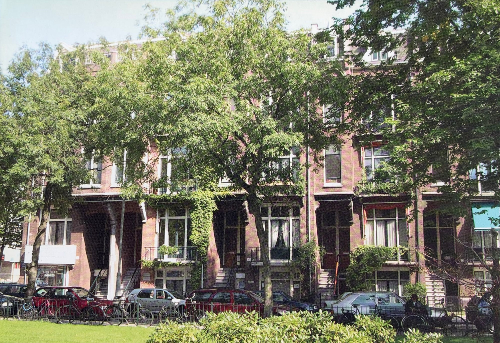
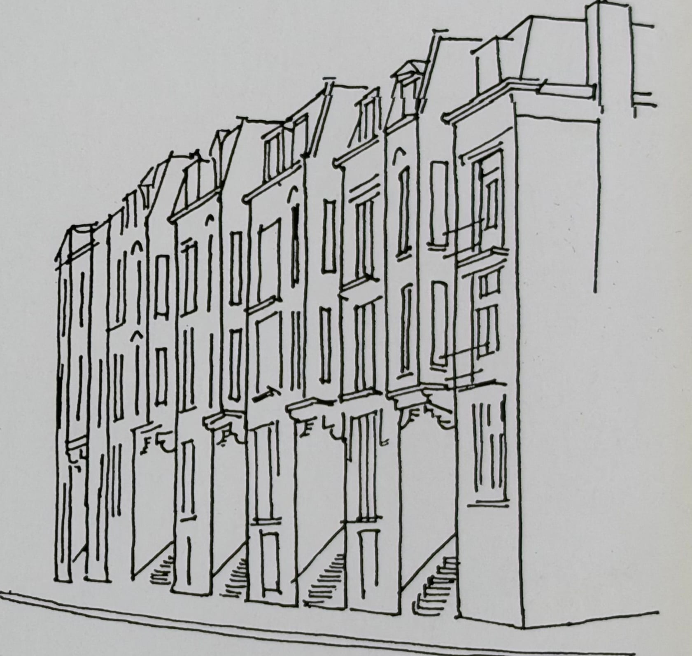
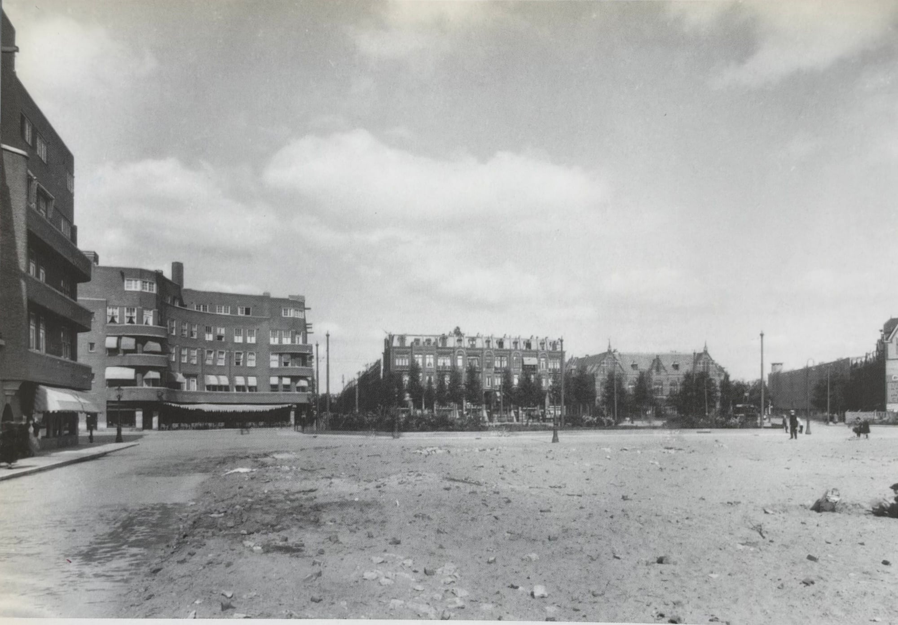
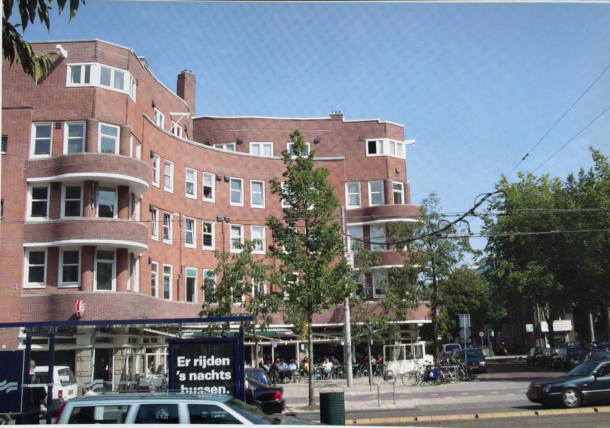

# Roelof Hartplein

_Perikelen bij de naamgeving_

De huizen Roelof Hartplein 13-23 werden in 1899 gebouwd naar ontwerp van architect J.F. van Hamersveld en stonden toen bekend als Roelof Hartstraat nummers 70-60[^1]. De eerste bewoners[^2] keken uit op tuinders-percelen en enkele laag gelegen tuinderswoningen. Het Roelof Hartplein werd eigenlijk pas compleet na de bouw van Huize Lydia in 1927 en Het Nieuwe Huis in 1928. Tien jaar eerder al had de gemeente het idee in de bocht tussen de straten een plein te formeren. Burgemeester en Wethouders van Amsterdam stelden in mei 1917 aan de raad voor deze locatie Roelof Hartplein te noemen. Enkele raadsleden kwamen echter in het geweer. Zou de naam Van Baerleplein niet beter zijn want: "Roelof Hart moge binnen plaatselijke grenzen een beroemdheid geweest zijn, hij kon toch minder dan de grote (geleerde/dichter) Barlaeus op beroemdheid bogen" en "Wat doet die Nieuweramstelse dokter tussen al die schilders?". Bovendien vond men de aard van de bebouwing aan het plein meer in overeenstemming met die van de Van Baerlestraat.

De meerderheid van de raad wilde de naam Van Baerlestraat invoeren voor het stuk van het Vondelpark tot aan het plein, maar over de naam van het plein kwam men niet tot overeenstemming. De beslissing werd uitgesteld tot de volgende raadsvergadering. Op 6 juni 1917 werd het geschil beslist ten gunste van Roelof Hart met een nipte meerderheid van achttien tegen zeventien stemmen.

Overigens bestaat ook nu nog wat verwarring rond het plein: iedereen heeft het over de school aan het Roelof Hartplein, maar dat gebouw staat nu juist aan de Roelof Hartstraat nummer 1.

[^1]: De oorspronkelijke markering liep vanaf de Amstelveense kant.
[^2]: De kunstschilder G.H. Breitner woonde van oktober 1920 tot eind april 1923 op Roelof Hartplein 23-1

## Foto's

### Roelof Hartplein 13-23

_Roelof Hartplein 13-23 zoals het er nu uitziet_ (p. 28)

_Roelof Hartplein 13-23_ (p. 29)

### Het plein, toen en nu

_Het Roelof Hartplein was in 1925 nog niet voltooid. Op de voorgrond staat nu Huize Lydia_ (p. 30)

_Roelof Hartplein zoals we het nu kennen_ (p. 31)
