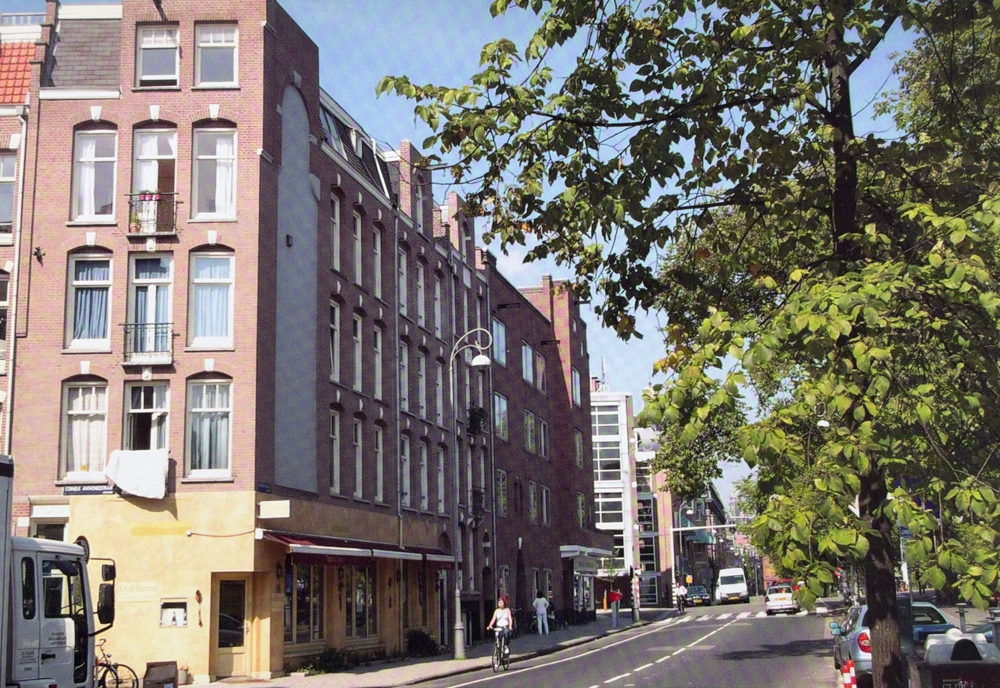
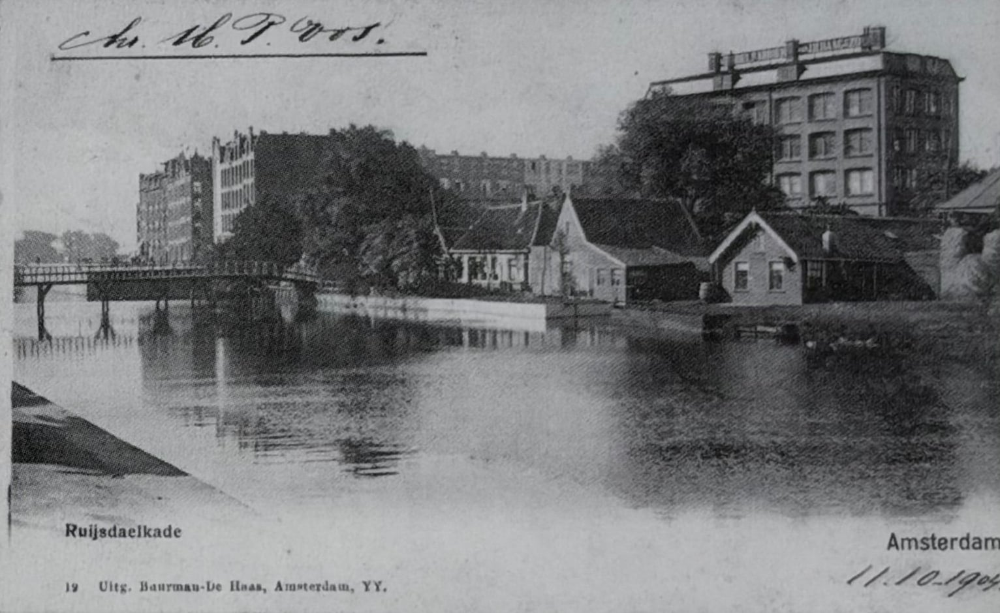
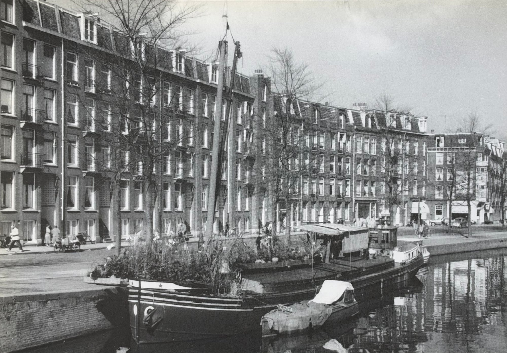
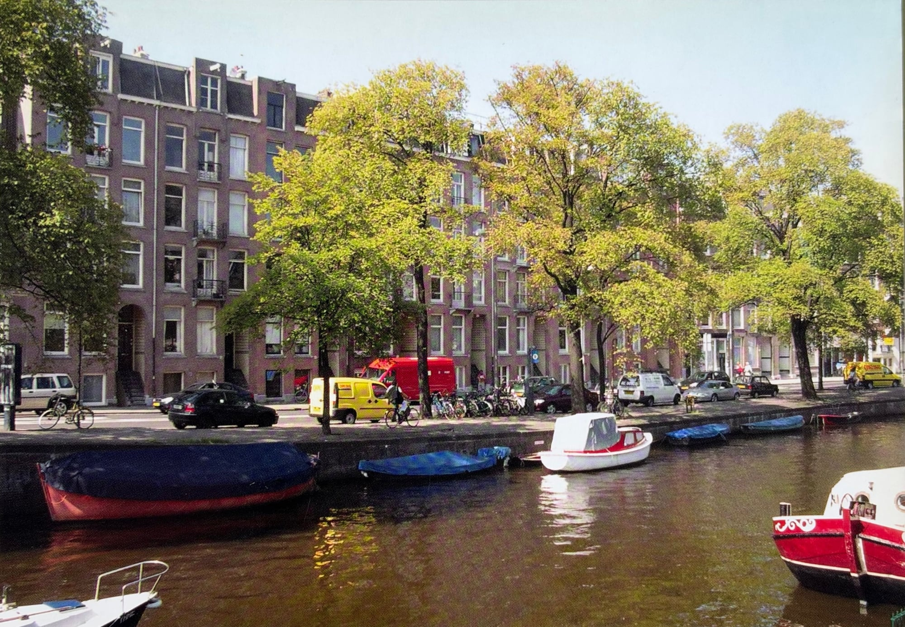

# Hobbemakade

_Hoe het groeide_

Het deel van de Hobbemakade dat hoort bij Duivelseiland werd aangelegd in 1898 tegelijk met de bouw van de eerste nieuwbouwpanden. Vóór die tijd lagen direct aan het water groentetuinen en vlakbij de oude houten brug over de Boerenwetering de vatenfabriek van Janus. Tot 1898 kon men aan de zuidzijde niet langs het water lopen maar alleen met een bootje bij een steiger afmeren.

De houten brug bij de Ruysdaelstraat is in 1907 vervangen door een vaste ijzeren brug. In verband met het tramverkeer zijn de brugpijlers in 1928 met kruiswerk versterkt. De brug tussen Duivelseiland en de Jan Steenstraat is al in 1897 aangelegd.

De bloemenboot die nu aan de Ruysdaelkade ligt, had vroeger zijn vaste ligplaats aan de Hobbemakade. Tot ver in de jaren zeventig lag ook een grote kolenschuit tegen de wallenkant. Daarop werden handzame zakjes met steenkolen gevuld, die te koop waren in het souterrain van Hobbemakade 61, tot de tijd dat iedereen massaal op gasverwarming overging.

De panden 61 tot en met 67 zijn gebouwd door J. H. Gottmer, die zelf tot 1913 op nummer 66 woonde. Het gevelontwerp, waarin het jaartal 1900 staat, is van architect J.H. Lesmeister, die zeer veel panden in Zuid en West op zijn naam heeft staan.

## Foto's

_Hobbemakade 63-57, anno 2004_ (p. 32)

_Op de prentbriefkaart, die Chr. Vos op 11-10-1904 verzond, zien we geheel links de gevels aan de Hobbemakade. Rechts de hoge meubelfabriek van Haag en tuindershuizen aan het water. Hier bevindt zich nu het Montessorilyceum. Dit stuk Hobbemakade werd pas in 1917 aangelegd en bestraat._ (p. 33)

### Tot aan de Balthasar Floriszstraat, toen en nu

_De Hobbemakade tot aan de Balthasar Floriszstraat in de jaren zeventig_ (p. 34)

_De Hobbemakade tot aan de Balthasar Floriszstraat anno 2004_ (p. 35)
