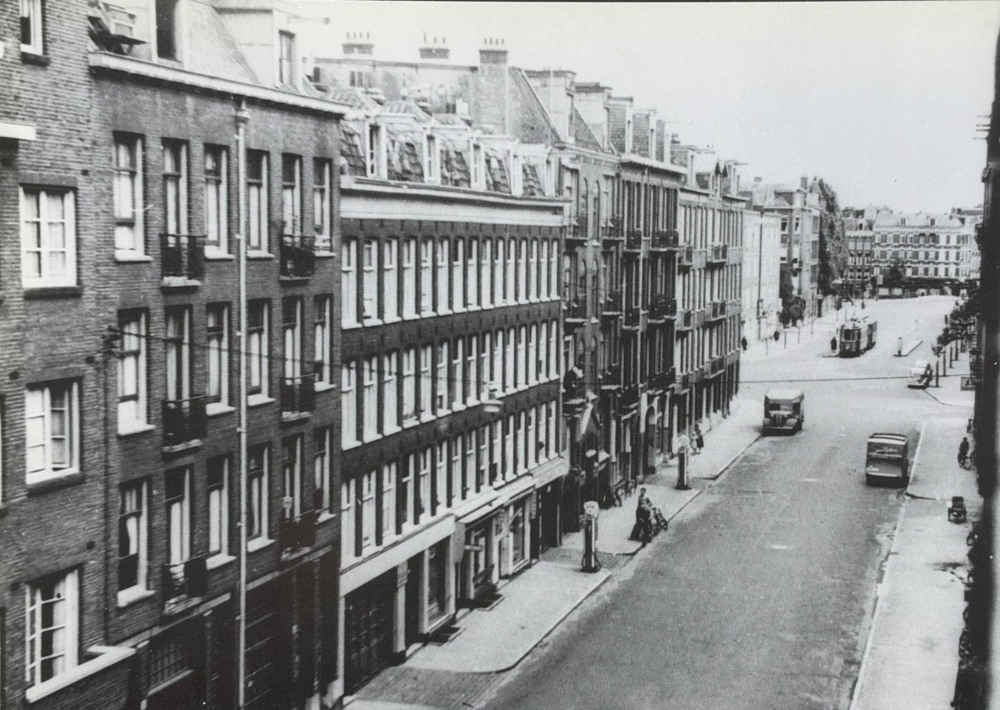
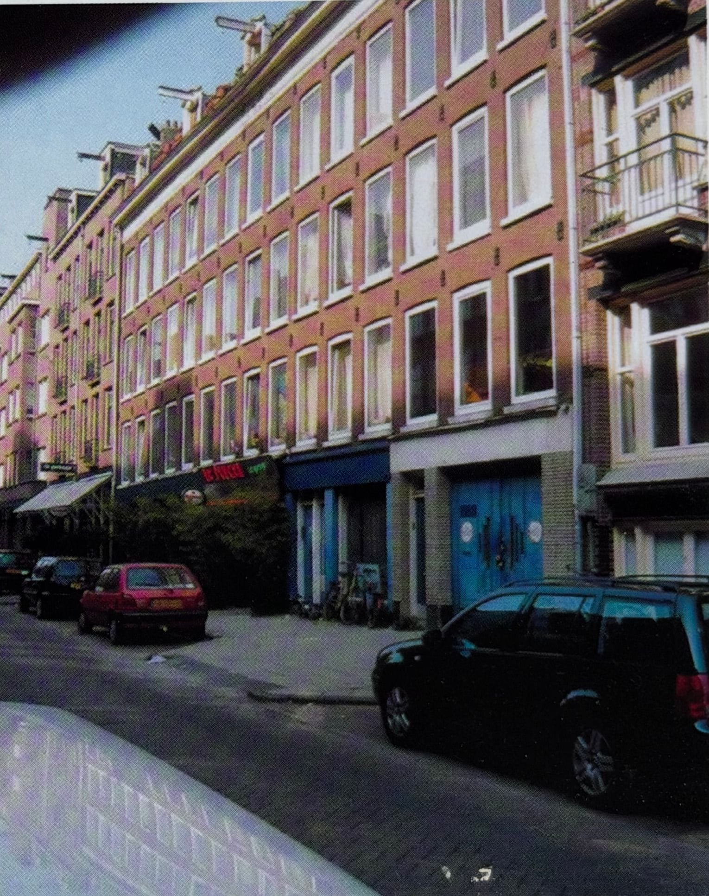
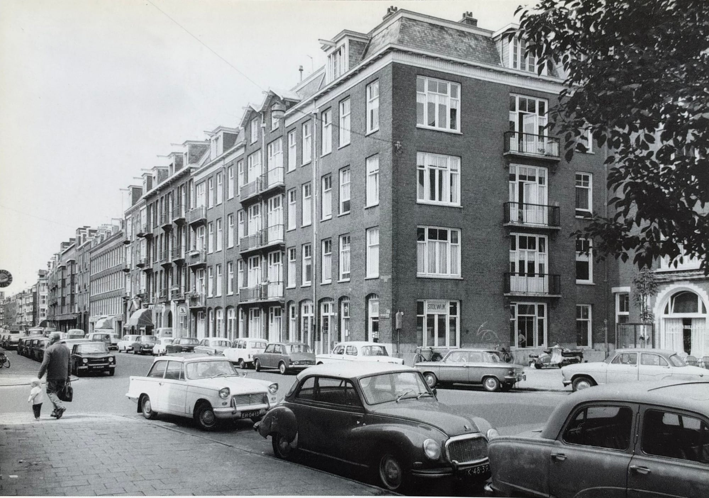
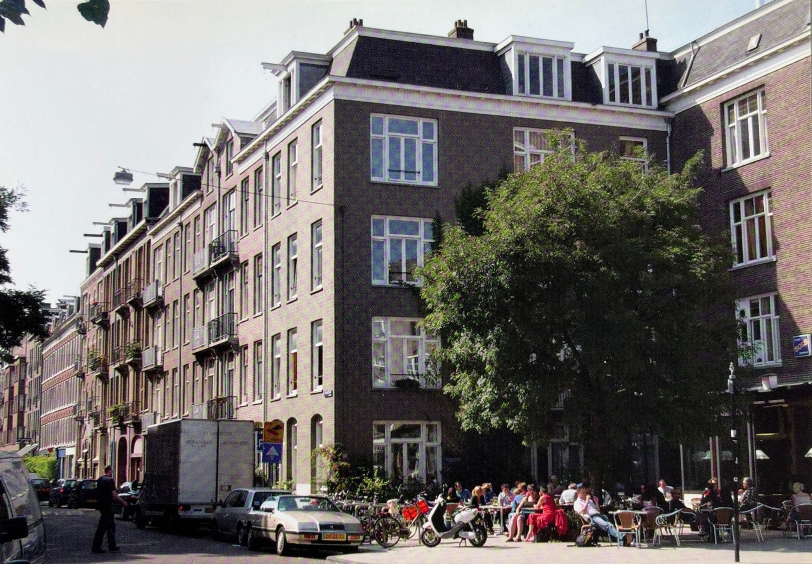
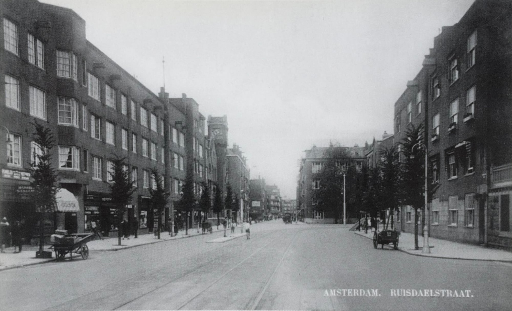
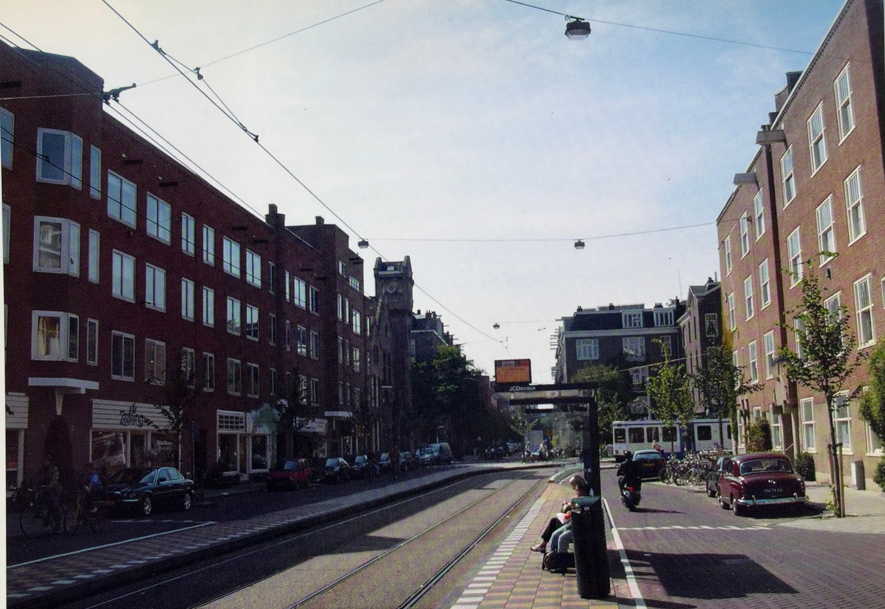

# Ruysdaelstraat

_Veel ouder dan de rest van Duivelseiland_

De Schagerlaan gaf in de zeventiende eeuw toegang tot een lange rij moestuinen en boomgaarden. Burgemeester en Wethouders van Nieuwer-Amstel gaven in 1879 toestemming tot wijziging van de straatnaam in Ruysdaelstraat. De naam gaf verwarring omdat er ook in de Watergraafsmeer een Schagerlaan was. De straat zelf is in het begin van de 20ste eeuw opgehoogd en verbreed. Dit heeft geleid tot een grote variatie aan bebouwing. In 1923-1924 verrees het blok 1 tot en met 25, waarvoor in totaal 27 oude woningen die op polderpeil lagen werden gesloopt (14 hiervan lagen in de Ruysdaeldwarsstraat). Tegelijkertijd kon een tweede tramspoor voor lijn 16 in de tien meter bredere straat worden gelegd. In 1923 werden ook Ruysdaelstraat 51 tot en met 57 opgeleverd. Deze huizen maken deel uit van een complex in Amsterdamse schoolstijl van architect G.J. Rutgers, dat doorloopt tot het Roelof Hartplein nummer 11.

Sinds 1907 was midden in de straat achter een fraai ijzeren hek de diamantslijperij van Eduard van Dam gevestigd. Dit pand is in 1995 door de ACOB, nu Stichting Eigen Haard/Olympus Wonen, verbouwd tot kantoren en appartementen en hebben de huisnummers 49 A-F. In 1914 werd de Oud-Katholieke kerk op de hoek van de Pieter Baststraat in gebruik genomen. De huizen 44 tot en met 52 dateren uit 1881. Bij de poort naar het achterterrein bevond zich in de vorige eeuw een garagebedrijf. De huidige eigenaar woningcorporatie Het Oosten heeft een plan voor nieuwbouw op deze plaats in voorbereiding. De overige panden aan de even zijde van de Ruysdaelstraat zijn in de jaren 1911-1913 gebouwd.

## Foto's

_Bedrijven en benzinepompen in de Ruysdaelstraat in het jaar 1954_ (p. 36)

_Geen bijschrift in het boekje._ (p. 37)

### Nummers 26 tot en met 56, toen en nu

_Een blik op Ruysdaelstraat nummers 26 tot en met 56 in 1968; ook toen al vol met auto's_ (p. 38)

_Een blik op Ruysdaelstraat nummers 26 tot en met 56, september 2004_ (p. 39)

### Tot de Johannes Vermeerstraat, toen en nu

_De Ruysdaelstraat tot de Johannes Vermeerstraat op een prentbriefkaart van ca. 1930_ (p. 40)

_De Ruysdaelstraat tot de Johannes Vermeerstraat anno 2004_ (p. 41)
