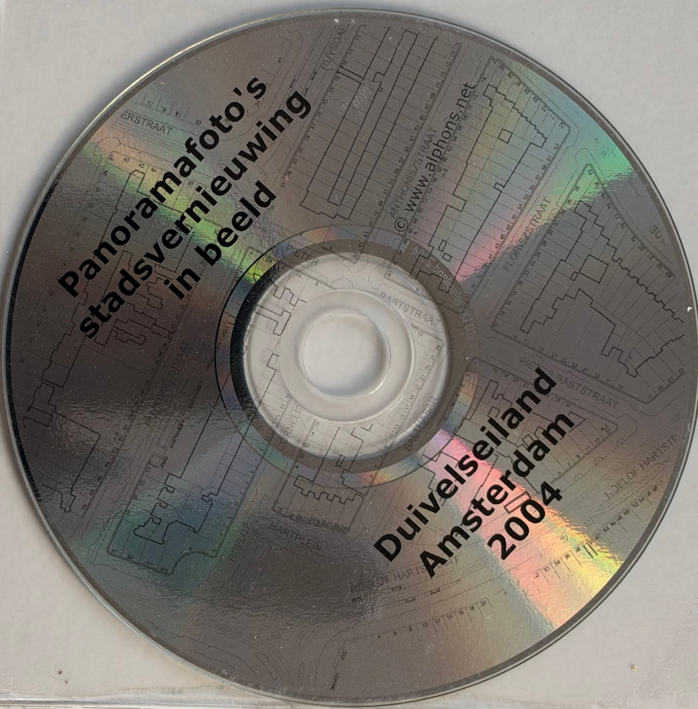

# CD-rom

Achterin het boekje zit een cd-rom in een plastic hoesje:

**Panoramafoto's stadsvernieuwing in beeld**
**Duivelseiland Amsterdam 2004**
© www.alphons.net

_De inhoud van de cd-rom (de panoramafoto's uit het voorwoord) is niet gescand._
